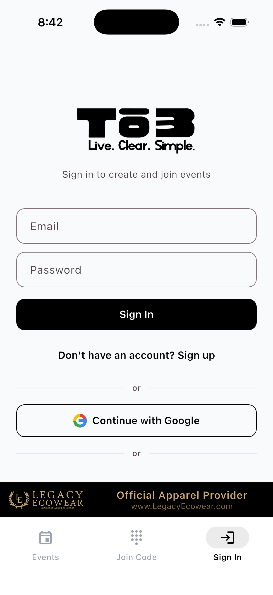
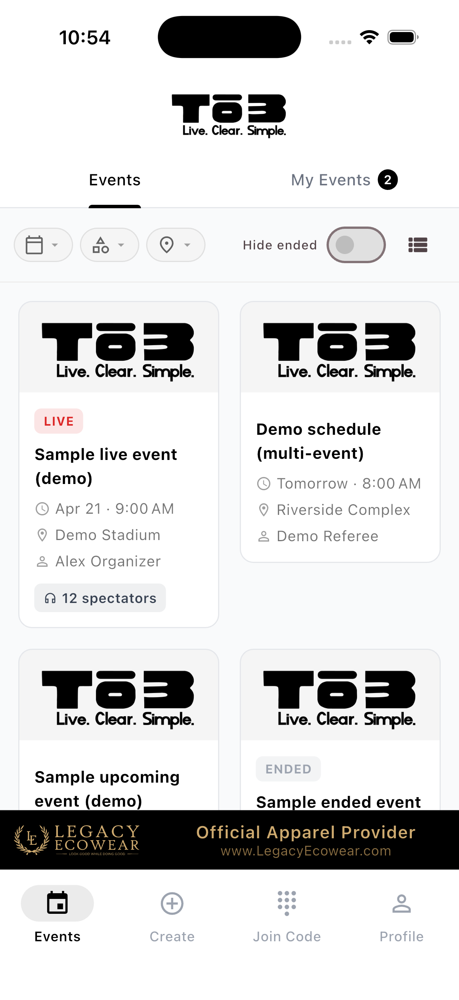
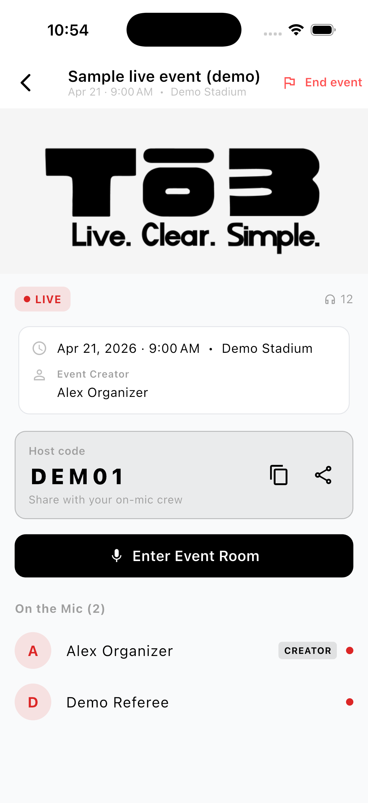

# Tō3: Live Voice for Event Crews

  <strong>Project Overview</strong> 
  <strong>Role:</strong> Product designer &amp; developer (solo) 
  <strong>Platform:</strong> Flutter (iOS + Android); earlier React PWA prototype 
  <strong>Realtime:</strong> LiveKit (rooms, JWT grants, Flutter SDK) 
  <strong>Tagline:</strong> Live. Clear. Simple.

## The problem

Event crews (referees, staff, volunteers) need live voice at the venue without desktop complexity or expensive radio infrastructure. Controls must work in bright sun, dark halls, and one-handed on a phone. Failures (bad audio route, failed join, wrong permissions) have to be recoverable before the match starts, not mid-play.

## The solution

**Tō3** is a LiveKit-powered real-time voice product: open a room, tap to join, stay with your crew on phones and Bluetooth headsets.

**Core capabilities:**

- **LiveKit rooms:** Real-time full-duplex voice with simple mute controls
- **Role-based access:** Server-issued JWTs enforce publish vs. subscribe by role (hosts can talk; listeners stay subscribe-only unless granted)
- **Connection preflight:** Separate connection-test room so hosts can verify devices before going live, without exposing failures to active listeners
- **Events & sessions:** Create events, add sessions, see hosts and listeners
- **Sign in:** Email or Google; same account across devices
- **High contrast UI:** Black and white, readable in any lighting
- **Venue-first:** Run everything from your phone; no desktop required

<figure style="display: flex; flex-wrap: wrap; gap: 16px; margin: 24px 0;">
  
  
  
</figure>

## LiveKit and real-time design

This is production LiveKit client work, not a slide deck:

- **Token grants:** Cloud Function mints JWTs with `canPublish` / `canSubscribe` scoped to room and identity. Dev-only client signing is locked off in release builds.
- **Test vs live rooms:** Preflight uses a distinct room purpose so audio-session and Bluetooth issues surface before the crew is on air.
- **Live-room UI:** Connection health, who is speaking, and mute/admin controls stay scannable under field pressure for non-technical users.
- **Failure modes:** Diagnosed WebRTC and audio-session issues (including iOS stack limits and simulator constraints) through iterative device testing while hardening native audio and background behavior.

## Design principles

- **Mic when it matters:** Microphone for live rooms; mute when not talking
- **Simple hierarchy:** Events → sessions → live room; minimal steps to join
- **Honest connection state:** Prefer a clear preflight failure over a silent mid-event drop
- **Free to host and join:** Low barrier for community and volunteer crews

## How it was built

Solo designer-developer workflow with Cursor and AI-assisted coding, GitHub, Flutter, Firebase (auth, Firestore, Cloud Functions), and the LiveKit Flutter SDK. Validated core mechanics on a React PWA prototype before the native client for audio session tuning and Bluetooth reliability.

## Outcomes

- Shipped Flutter app with store-ready marketing assets
- Production LiveKit access patterns (rooms, JWT grants, connection preflight) in a real field product
- Extends product work beyond rugby officiating into event operations

## Part of the suite

Tō3 is one app in my [published product suite]({{ '/portfolio/product-suite/product-suite/' | relative_url }}) for sports officials and event crews (schedule → travel → live voice → review).
